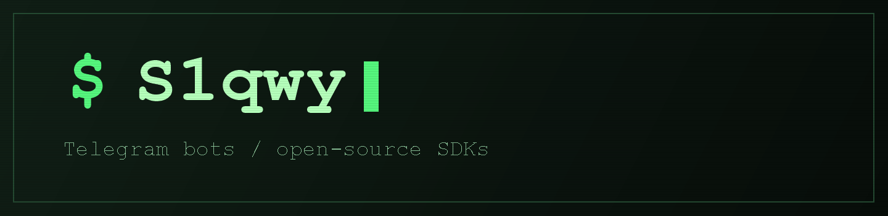

  

## `$ whoami`

I'm **S1qwy**. I build Telegram bots and open-source SDKs. I like turning a workflow that lives in DMs and spreadsheets into something you can run from `/start`.

## `$ cat ~/stack`

## `$ ls ~/projects`

| Project | What it does |
| --- | --- |
| **Fragment API** · [Python](https://github.com/S1qwy/fragment-api-py) / [TypeScript](https://github.com/S1qwy/fragment-api-ts) / [Go](https://github.com/S1qwy/fragment-api-go) | Unofficial SDKs for Telegram Stars, Premium, gifts, and TON. |
| **[pyTelegramOIDC](https://github.com/S1qwy/pyTelegramOIDC)** | Async Python library for adding Telegram sign-in with OpenID Connect. |

## `$ cat ~/availability`

**Open for Telegram bot commissions.** I build bots for orders and bookings, community moderation, alerts, and API or webhook integrations. I can also add features to a bot you already use.

Send me what the bot should do, who will use it, and any deadline you have in mind. **[Message me on Telegram → @user_s1qwy](https://t.me/user_s1qwy)**
